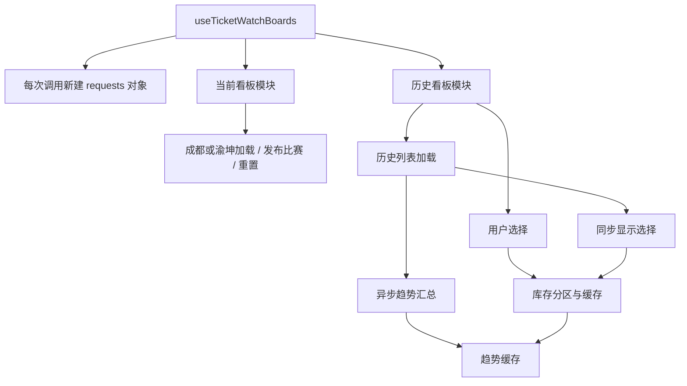

# 大文件拆分验证记录（2026-10-15）

对应计划：[`2026-10-large-file-splitting.md`](./2026-10-large-file-splitting.md)。基线 `9d5eed1`；最终交付分支 `codex/large-file-splitting-isolated`。本次为纯重构，保留业务行为、文案、接口与路由。执行顺序为 1 → 2 → 4 → 3，把请求并发状态拆分放在最后。

## 本地提交与规模

| 阶段 | 提交 | 入口变化 |
| --- | --- | --- |
| 1 战术板 | `db3f779` | `team-board/index.vue` 728 → 135 行，script 219 → 43 行；五个展示组件、页面 composable 与不可变状态更新 helpers |
| 2 helpers 门面 | `518729a` | home 742 → 5 行；ticket-watch 906 → 6 行；12 个新模块均 ≤291 行 |
| 3 看板请求 | `1bb8b6d` | `useTicketWatchBoards.ts` 751 → 152 行；当前模块 240、历史模块 448、请求状态模块 32、API 类型模块 13 行 |
| 4 局部流程 | `36fce36` | seat-swap 626 → 466 行（script 419 → 259）；发布弹层 686 → 447 行（script 273 → 33）；排行榜面板 672 → 285 行 |

## helpers 兼容核对

| 页面 | 运行时导出 | 类型导出 | 原声明 | 保持绑定的标识符 |
| --- | ---: | ---: | ---: | ---: |
| home | 25 → 25 | 7 → 7 | 45 | 1,299 |
| ticket-watch | 40 → 40 | 18 → 18 | 60 | 1,258 |

TypeScript AST/TypeChecker 核对声明、导出类型与标识符来源；Bun 导入核对运行时导出及门面/领域模块符号身份。105 个声明保持原实现（仅内部共享 block-key 函数增加供同页引用的 export），25 个导入方和现有测试不变。14 个模块的 import/re-export 图（包括类型边）无环；内部共享函数未泄漏到公开门面。ticket-watch 与 user 的邮箱校验实现相同，本次按计划各自保留。

## ticket-watch 请求状态归属

拆分前先确认调用关系，装配入口随后保持同一 API、会话和状态引用：

当前/历史模块不互相调用；`ensureRegions` 由入口显式注入，当前模块另接收原订阅刷新回调。所有请求局部 owner/revision/team/token 仍在函数调用闭包内捕获。

| 可变值 | 所属位置与更新者 |
| --- | --- |
| `currentBoardRequestSeq` | 每实例 requests；当前加载/重置递增 |
| `activeCurrentBoardRequest` | 同一对象；当前加载设置、检查、清理，重置清空，两队 loader 检查 |
| `historyBoardRequestSeq` | 同一对象；历史列表加载/重置递增 |
| `activeHistoryBoardRequest` | 同一对象；列表加载设置、检查、清理，重置清空，两队 loader 检查 |
| `historySelectionRequestToken` | 同一对象；列表同步与用户选择共享，重置也递增 |
| `historyTrendRequestSeq` | 同一对象；趋势加载与重置使用，旧 finally 不能清新 loading |
| `currentBoardGeneration` | 原页面 state ref；由当前比赛发布/重置更新，独立于请求 owner |
| loading、inflight、缓存、数据 | 原注入 state refs，仍由原职责函数更新 |

## 已完成的验证

- 基线：类型检查、依赖边界检查通过，641 项测试通过。
- 阶段 1：类型检查、依赖边界、649 项测试、`MINI_REVIEW_SKIP=1 bun run build:mp-weixin` 通过；组件注册与生产 API 产物校验通过。新增 8 项战术板不可变状态更新测试；原断言保留。
- 阶段 2：类型检查、依赖边界、649 项测试通过；独立审查再次确认导出、声明与无环依赖。
- 战术板 H5：390×844 下，以同一模拟数据挂载基线和拆分后 SFC，比较可见文本、布局矩形与关键计算样式，以及发布弹层；所有比较一致。模拟请求覆盖发布、点赞、评论成功后的模型草稿清空和失败后的草稿保留；请求方法、路径、payload 一致。

- 阶段 4：类型检查、依赖边界、649 项测试、离线小程序构建和组件注册通过。45 个原函数的规范化 AST 保持一致（表单 submit 改由回调转发同一 emit）；换座页/发布弹层模板与 CSS 完全一致，排行榜 48 个 CSS 块保留。
- 发布表单 H5：390×844 模拟新建、当前区/目标区/联系方式步骤、上一步、校验失败、编辑回填、定向换座、重新打开清空；各状态文本、几何尺寸、关键计算样式与提交事件 payload 和基线一致。
- 排行榜 H5：同屏宽比较积分含/不含罚分、非积分球队榜、球员射手/助攻榜；类别/范围切换及球队、球员、单场事件保持一致。

- 阶段 3：类型检查、依赖边界、649 项测试通过；20 个函数的规范化 AST 与变量来源保持一致。原 API 方法按原顺序捕获一次，公开签名及九个返回成员保持原样；既有 effects 测试、调用方未改。独立审查确认当前/历史的重置顺序、owner/token/revision 检查、缓存与 finally 保护保留。
- 最终隔离工作区：锁文件安装、类型检查、边界检查、649 项测试（52 文件）、H5 生产构建、离线 MP 构建、组件注册和生产 API 产物校验重新通过。新工作区首次构建因缺少忽略的 `.env.production` 被门禁阻止，复制现有配置并确认 Git 忽略后通过；未复制上传私钥、未分配版本。

## 执行取舍

- 使用计划明确指定的新分支与当前干净 checkout，未另建 worktree；实现者串行操作。若共享工作目录出现并行修改，隔离性不如独立 worktree，需要重新核对提交范围。
- 按 1 → 2 → 4 → 3 执行，让最高风险的并发状态拆分最后进行；所有阶段均保留独立提交，若存在未识别的跨阶段依赖，需复核执行顺序。
- 按仓库前端约定，仅新增计划要求的 8 项状态更新测试，其他提取用现有测试、源代码核对、构建及 H5 对比验证；未覆盖的微信原生行为仍需人工验收。
- 换座页 script 保留 259 行，未达到约 200 行目标。原计划要求页面保留加载、导航、弹层、区域和滚动编排；避免为行数再扩大提取范围，代价是页面仍比目标多约 59 行。

- 施工中共享 checkout 出现无关弹框提交 `19db4ba`；保留原目录及全部提交，使用 Codex 托管 worktree 从 `36fce36` 继续，只 cherry-pick 本阶段的 `38f6587` 为 `1bb8b6d`。最终分支不包含外部提交；代价是原 `codex/large-file-splitting` 混合分支仍保留，后续应使用这里指定的 isolated 分支。

## 验证边界与发布状态

浏览器检查使用拦截的模拟 API，没有写生产数据。H5 不能替代微信原生组件样式隔离、触控、键盘与真机布局验收；本次未在微信开发者工具或真机验证。构建的 uni-app/caniuse-lite 更新提示为现有提示，未升级依赖。

交付工作区：`/home/betalpha/.codex/worktrees/large-file-splitting/football_insight`。仅本地分阶段提交；未合并 main、未推送、未上传小程序、未部署。本地和生产后端均未修改、未重启。
